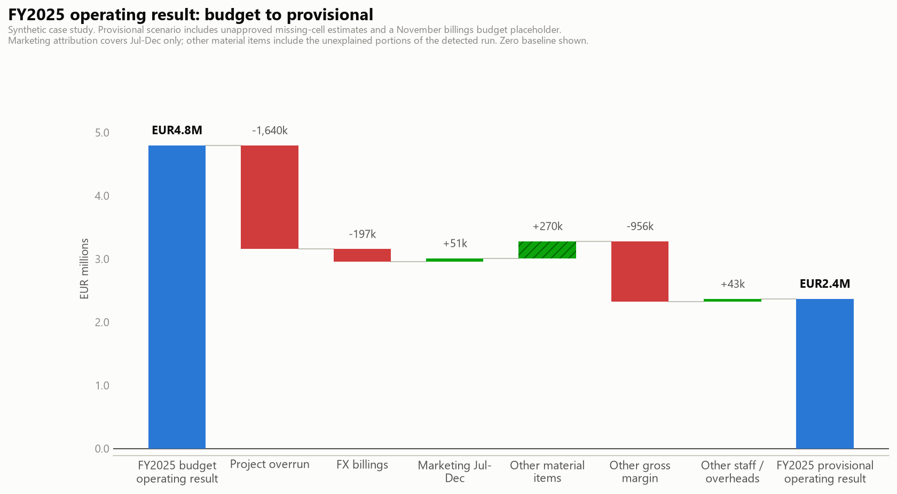

# FP&A reporting automation

I built this synthetic case study to show how Python automation and Claude agents can support an FP&A review, from source files to a management report. Financial judgment and approval stay with the analyst.

EventCo is a fictional events agency with four business lines. The reporting cycle draws on my experience as Head of FP&A at a EUR100M events agency. All amounts, events, notes and analyst explanations in this repository are synthetic.

The reporting date is 30 June 2026. The management assessment covers FY2025, the forecast covers Q3 2026, and the historical appendix covers January 2024-June 2026.

## From source files to a management review


Python cleans the files, computes variances and forecasts, and reconciles the figures. The investigation agent chooses financial checks, requests operating-driver breakdowns and reads relevant dated notes. A separate reporting agent selects the useful facts and proposes questions for the manager. Both receive a short company brief defining the business model, financial terms and review rules.

A successful live run produces `output/agent_review.md` and its activity record from actual Claude responses on synthetic data. The analyst instructions and follow-up are illustrative examples, not a claim that a live employer review took place. The record includes the agent's chosen checks, recomputed tool results, selected facts and proposed questions. Final approval remains with the analyst. An unavailable provider never produces a fabricated example.

The analyst defines the assignment, challenges assumptions, investigates unresolved items and selects the final management actions. Neither agent has a tool to correct source amounts, approve forecast adjustments or distribute reports. Branding follows the report template; company context focuses on the meaning of the numbers.

## Read the reports

Start with the [Brand Events business review](output/bu_reports/brand_events.pdf), then the [executive assessment](output/executive_summary.md). The [draft management pack](output/board_pack.md) includes variance analysis, the forecast and validation results. The [public case study](https://alanvourch.com/fpa-project/) presents the project; the local build is under `showcase/_site/`.



FY2025 provisional operating result is approximately EUR2.4M against a EUR4.8M budget comparator. Brand Events posts a provisional annual operating loss. A project cost overrun and FX loss account for major adverse items; below-threshold margin shortfalls also accumulate. These results require a management response.

The figures include unapproved estimates for missing source cells and a budget placeholder for November 2025 Brand Events billings. They are an optional demonstration scenario, not confirmed accounting actuals or an approved reconstructed budget. Source verification remains open.

## Financial definitions and source handling

Net billings are invoiced amounts. Cost of sales covers client-project purchases and external production crews. Gross margin is billings less cost of sales. Operating result is gross margin less staff costs and overheads. This simplified management P&L does not implement accounting revenue recognition, ARR or ACV restatement, a full accounting close, or SAP/BPC integration.

`data/eventco_monthly_cleaned.csv` preserves all nine source gaps. It corrects formatting and names and removes identical duplicates. Conflicting duplicates stop the run. A ratio above 4x or below 0.25x budget triggers source review; it does not establish that the observation is wrong or justify discarding it.

Without `--provisional`, source gaps stop downstream reporting. The optional scenario uses previous observed values within the same series. An opening actual with no earlier observation uses a same-month budget placeholder. It never uses a later month to estimate an earlier one. Estimates and the cell-specific November billings assumption are logged in `output/reporting_adjustments.csv`.

The variance CSV keeps `actual` and `budget` as source columns, beside separate `provisional_actual` and `provisional_budget` columns. Variance amounts and flags use the provisional columns and carry a reporting-basis label. Approved corrections should be supplied at source, with the obsolete placeholder removed from `data/reporting_policy.json` after review.

## Forecast and recurrence review

The forecast uses the same month in the prior year times median year-over-year growth over the last 12 observed months, by business unit and line. Materiality does not establish recurrence. Single-month and multi-month effects remain in history unless a confirmed one-off has explicit approval, evidence and a replacement value in `data/forecast_reviews.csv`.

The review file accepts `confirmed one-off`, `continuing structural effect`, `timing shift` or `unresolved`, with `proposed` or `approved` status. Approved one-offs require reviewer, review date, evidence and a non-negative replacement. Reviews dated after a historical cutoff cannot affect that fold. Timing and structural effects are retained until a separate future schedule is specified. No recurrence approvals are supplied for this case study.

The report shows the raw source baseline, the selected provisional baseline and an unapproved diagnostic that neutralizes every material month. The diagnostic is a sensitivity, not a confidence interval or an approved forecast. On this dataset, the raw and selected forecasts coincide despite the November placeholder because the median growth factor and seasonal bases are unaffected by that single observation.

Four overlapping three-month holdouts compare seasonal growth with seasonal naive forecasts. Training uses only observations and reviews available at each cutoff; missing or flagged source targets are excluded. The current growth method has higher mean absolute error than seasonal naive on this short synthetic sample. That finding calls for further model review and does not establish performance on employer data.

Corporate Events' detected marketing run spans April 2025-February 2026, while the notes support in-housing only from July through December 2025. Only that documented period receives the cause attribution. Earlier and later months remain a timing/cause follow-up.

## Commentary and validation

The default executive summary is rendered locally from a statement catalogue. Each fact binds business unit, period, metric, signed amount, direction and evidence. Validation recomputes that catalogue from the current outputs and checks both the claim ledger and the exact rendered statements. Required losses, the annual shortfall, source uncertainty and unresolved items must be included.

This is constrained commentary. Arbitrary new prose fails closed; the validator does not claim to understand every possible financial assertion. A wording change requires an explicit template change and review. The regression suite tests wrong business units, wrong periods, wrong signs, omitted losses, invented amounts and unsupported reassurance, alongside source preservation, recurrence approval and forecast leakage.

The orchestrator returns a failing exit status when any required step fails, writes a failed-review notice, and invalidates `output/release_status.json`. A site build requires passing validation for the exact current source and artifacts. It does not constitute approval for report distribution. A human still reviews the draft and authorizes publication.

## Run locally

Use Python 3.12 and the pinned packages in `requirements.txt`. Run from the repository root.

```powershell
python -m venv .venv
.venv\Scripts\pip.exe install -r requirements.txt
.venv\Scripts\python.exe orchestrator.py --provisional
.venv\Scripts\python.exe showcase/build_site.py
.venv\Scripts\python.exe -m http.server 8765 --bind 127.0.0.1 --directory showcase/_site
```

On macOS/Linux, use `.venv/bin/python` and `.venv/bin/pip` for the equivalent commands. Open the local server in a browser. Building does not publish. The repository's existing `gh-pages` workflow remains a separate release action.

The pipeline runs ingestion, variance analysis, forecast, four business-line PDFs, commentary, charts, six validation scripts, financial-control tests, agent scope/replay tests and the QA gate. `output/pipeline_log.md` records their results. Calculations are reproducible for fixed inputs. The default commentary is deterministic; optional AI ordering is not guaranteed to be identical on fresh calls.

## Live agents, recorded replay and data handling

The default pipeline makes no new AI call. It replays `data/agent_run.json` and recomputes each requested financial check against the current inputs. Changed company context, prompts, workflow code or hashed source artifacts invalidate that record and stop the run. Text fingerprints normalize Windows and Unix line endings. A cached response cannot silently stand in for a fresh analysis of different data.

To run a new investigation and reporting session with the current synthetic inputs:

```powershell
.venv\Scripts\python.exe orchestrator.py --provisional --live-agents
```

If `ANTHROPIC_API_KEY` is set in the environment or the git-ignored `.env` file, the agents use the Anthropic API directly. The API path uses Sonnet 5, counts input tokens before generation and reserves the maximum output allowance against an estimated $1 run cap at the published $2/$10 per million input/output token rates. Retries are disabled. The cap is a local token-cost estimate, not a provider billing limit. Without an API key, the adapter uses the installed Claude Code CLI and its existing login. The adapter runs without built-in tools, MCP servers or project/user customizations. Python dispatches a small allowlist of read-only checks. `FPA_AGENT_MODEL` selects the configured model alias, defaulting to `sonnet`. The CLI must support the flags used in `agents/narrative_agent.py`. Authentication or provider failure stops the run; there is no fabricated fallback conversation.

The live session sends the synthetic company brief, scoped facts, analyst instructions and selected tool results to Claude. Visiting the static case-study page makes no AI request. Full activity is saved in `output/agent_review.json`; only structured decisions and returned checks are recorded, not private chain-of-thought.

The legacy `--ai` option orders the executive statement catalogue through the configured Anthropic-compatible API. It is separate from the investigation example and is not needed for the standard or live-agent workflow.

Facts in the manager brief retain their original unit, period, signed amount and evidence. The model selects fact IDs rather than supplying new monetary figures. Generated questions remain proposals for human review. Scope, citation and replay checks do not establish that every question is commercially sound or prove the underlying source is correct.

Business notes and briefs can contain identifying client names and context. Aggregation does not anonymize them. Live employer data requires an approved provider and confidentiality policy. Source scans are limited regression checks, not runtime network isolation or comprehensive data-loss prevention. No credentials are committed.

No step distributes reports. A fresh Claude run may choose different checks or questions; deterministic calculations and replayed results are reproducible for fixed inputs.

## Limits

- The synthetic dataset and operational drivers are consistent by construction. A real HR/CRM reconciliation needs tolerances and an explicit unallocated difference.
- The 13 analyst explanations are illustrative text over seeded noise, not investigative findings. A dated business note is evidence of context, not independent proof of every cause or amount.
- The two unexplained material items remain open. The partial marketing attribution and source uncertainty remain additional review actions.
- Support staff and overheads are allocated to the four business lines. A real management pack should also show central cost centres before allocation.
- There is no measured before/after productivity benefit, real-client deployment or production confidentiality control demonstrated here.

See [canonical figures](FIGURES.md), the [audit repair record](docs/audit-repairs.md) and [agent design choices](docs/agent-design.md), including a comparison with Anthropic's finance templates.
