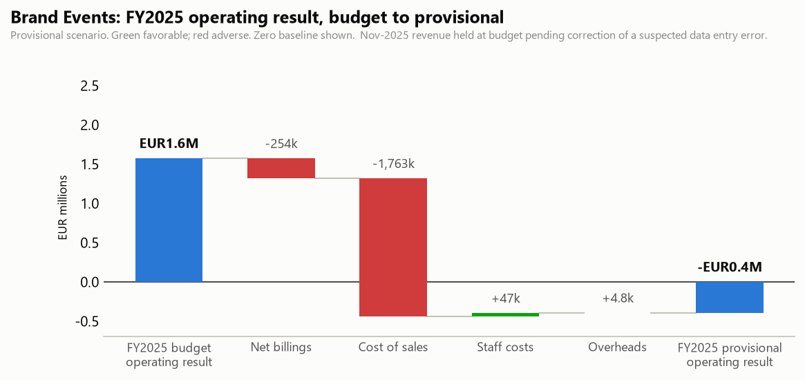

# Brand Events: FY2025 provisional review and Q3 2026 outlook

One-page business review for the BU manager. Generated by `agents/bu_report_agent.py` from the pipeline's own outputs (`output/variance_table.csv`, `output/forecast.csv`, `data/eventco_drivers.csv`, `data/business_notes.csv`). This agent never reads `data/ground_truth.md`.

## FY2025 provisional scorecard

> As of 30 June 2026. Source gaps use unapproved estimates. Brand Events November billings use a budget placeholder pending verification. See reporting_adjustments.csv. Price/mix and rate effects are decompositions, not independently verified causes.

| | Provisional | Budget comparator (includes estimates) | Variance |
|---|---|---|---|
| Net billings | EUR47,447,991 | EUR47,701,839 | -254k |
| Gross margin | EUR7,046,599 | EUR9,063,349 | -2,017k |
| Staff costs and overheads | EUR7,437,739 | EUR7,489,428 | -52k |
| Operating result | -EUR391,140 | EUR1,573,921 | -1,965k |

Operating margin -5.6% of gross margin, -0.8% of net billings. Nov-2025 revenue held at budget pending correction of a suspected data entry error.

## What drove it

- Payroll ran -30k vs budget. Headcount effect -26k (average 54.6 FTE vs 55.0 planned), rate effect -4.5k (arithmetic residual, not a verified cause). The two effects reconcile to the payroll variance.
- Net billings ran -254k vs budget (excluding the month pending data correction). Volume effect +1,494k (146 projects delivered vs 141 planned), price/mix residual -1,748k. The two effects reconcile exactly to the net billings variance.
- *Data note:* 2025-11 is excluded from the revenue split above. The ops system shows normal activity that month (17 projects delivered vs 17 planned), which supports treating the source-verification follow-up. It does not prove a data entry error.

## Material variances (full 30-month window)

| Period | Line | Variance EUR | % | F/U | Driver |
|---|---|---|---|---|---|
| 2025-04..2025-06 | Cost of sales | +1,639,708 | +14.2% | U | Scope expansion raised production costs; partial recovery only. (business note N11, N13) |
| 2026-04 | Cost of sales | +457,333 | +12.0% | U | An unplanned client project was won in late March and delivered inside April; external production was booked at short-notice premium rates. (analyst input, manual) |
| 2026-04 | Net billings | +388,823 | +8.3% | F | Unbudgeted revenue from the same late-won April project; see the matching COGS variance. (analyst input, manual) |
| 2024-11 | Cost of sales | -346,813 | -8.5% | F | November events were delivered with in-house crew and staging stock instead of the subcontracting assumed in budget; Q4 freight was also renegotiated. (analyst input, manual) |
| 2025-07 | Net billings | +247,346 | +7.3% | F | A client brought part of its September roadshow forward into July. (analyst input, manual) |

## Follow-ups

- BU manager: review project recovery and margin controls with group FP&A; agree an action plan for the annual operating loss.
- Verify the Nov-2025 revenue entry at source: the ratio triggers review while the ops system shows normal project activity. Verify the invoice source; the budget placeholder is unapproved.

## Q3 2026 outlook (Jul 2026 / Aug 2026 / Sep 2026)

Net billings EUR10,681,752 (+8.1% vs the same quarter last year), gross margin EUR2,680,616 (+29.8%), operating result EUR812,471, 30.3% of gross margin. Unresolved historical effects are retained unless explicitly approved as one-off adjustments; see the forecast report and sensitivities.

---

DRAFT: pending human sign-off. Nothing in this pipeline distributes reports on its own.
