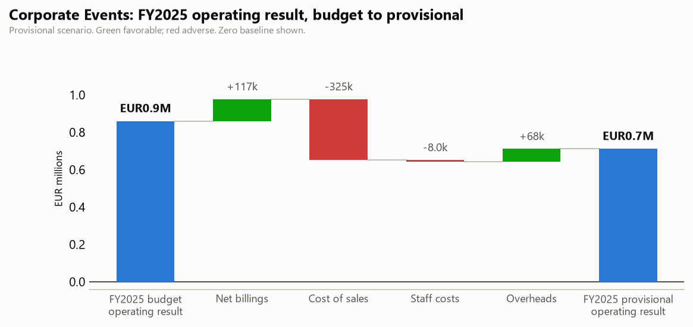

# Corporate Events: FY2025 provisional review and Q3 2026 outlook

One-page business review for the BU manager. Generated by `agents/bu_report_agent.py` from the pipeline's own outputs (`output/variance_table.csv`, `output/forecast.csv`, `data/eventco_drivers.csv`, `data/business_notes.csv`). This agent never reads `data/ground_truth.md`.

## FY2025 provisional scorecard

> As of 30 June 2026. Source gaps use unapproved estimates. Brand Events November billings use a budget placeholder pending verification. See reporting_adjustments.csv. Price/mix and rate effects are decompositions, not independently verified causes.

| | Provisional | Budget comparator (includes estimates) | Variance |
|---|---|---|---|
| Net billings | EUR21,317,881 | EUR21,200,817 | +117k |
| Gross margin | EUR5,303,857 | EUR5,512,213 | -208k |
| Staff costs and overheads | EUR4,592,443 | EUR4,652,326 | -60k |
| Operating result | EUR711,413 | EUR859,886 | -148k |

Operating margin 13.4% of gross margin, 3.3% of net billings.

## What drove it

- Payroll ran +4.4k vs budget. Headcount effect 0k (average 30.0 FTE vs 30.0 planned), rate effect +4.4k (arithmetic residual, not a verified cause). The two effects reconcile to the payroll variance.
- Net billings ran +117k vs budget. Volume effect -202k (210 projects delivered vs 212 planned), price/mix residual +319k. The two effects reconcile exactly to the net billings variance.

## Material variances (full 30-month window)

| Period | Line | Variance EUR | % | F/U | Driver |
|---|---|---|---|---|---|
| 2024-10 | Net billings | +215,565 | +10.5% | F | A brand activation sold for early 2025 was pulled into October at the client's request. (analyst input, manual) |
| 2024-10 | Cost of sales | +212,500 | +13.9% | U | Production costs of the pulled-forward October activation; see the matching revenue variance. (analyst input, manual) |
| 2025-04..2026-02 | Opex - Marketing | -81,464 | -16.4% | F | In-housing documented Jul-Dec 2025; other months need review. (business note N12, N16) |

## Follow-ups

- BU manager: explain the savings before July 2025 and after December; confirm which effects continue.
- BU manager and FP&A: review the Q3 forecast operating loss of EUR143k; agree a margin and cost response.

## Q3 2026 outlook (Jul 2026 / Aug 2026 / Sep 2026)

Net billings EUR4,407,508 (+3.5% vs the same quarter last year), gross margin EUR992,148 (-5.8%), operating result -EUR142,779, -14.4% of gross margin. Unresolved historical effects are retained unless explicitly approved as one-off adjustments; see the forecast report and sensitivities.

---

DRAFT: pending human sign-off. Nothing in this pipeline distributes reports on its own.
