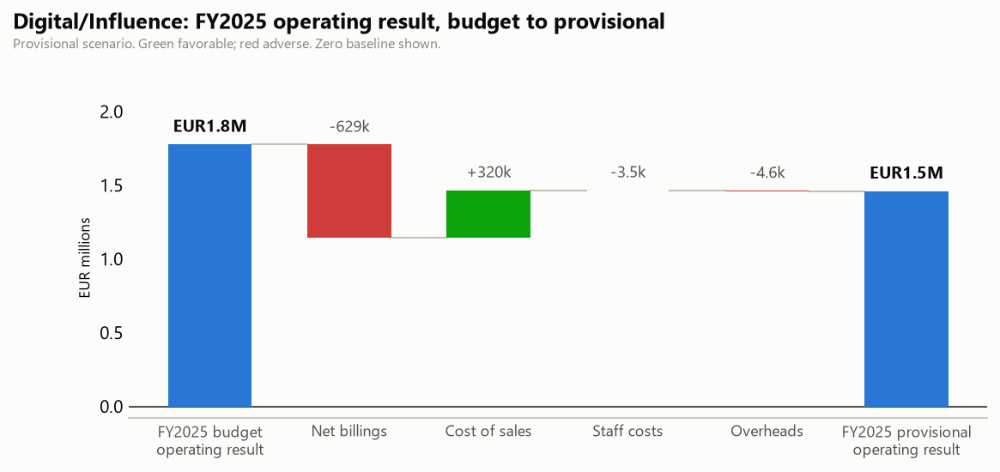

# Digital/Influence: FY2025 provisional review and Q3 2026 outlook

One-page business review for the BU manager. Generated by `agents/bu_report_agent.py` from the pipeline's own outputs (`output/variance_table.csv`, `output/forecast.csv`, `data/eventco_drivers.csv`, `data/business_notes.csv`). This agent never reads `data/ground_truth.md`.

## FY2025 provisional scorecard

> As of 30 June 2026. Source gaps use unapproved estimates. Brand Events November billings use a budget placeholder pending verification. See reporting_adjustments.csv. Price/mix and rate effects are decompositions, not independently verified causes.

| | Provisional | Budget comparator (includes estimates) | Variance |
|---|---|---|---|
| Net billings | EUR25,872,171 | EUR26,501,022 | -629k |
| Gross margin | EUR8,171,376 | EUR8,480,327 | -309k |
| Staff costs and overheads | EUR6,713,035 | EUR6,704,903 | +8.1k |
| Operating result | EUR1,458,341 | EUR1,775,424 | -317k |

Operating margin 17.8% of gross margin, 5.6% of net billings.

## What drove it

- Payroll ran 0k vs budget. Headcount effect -17k (average 44.8 FTE vs 45.0 planned), rate effect +17k (arithmetic residual, not a verified cause). The two effects reconcile to the payroll variance.
- Net billings ran -629k vs budget. Volume effect +355k (154 projects delivered vs 152 planned), price/mix residual -984k. The two effects reconcile exactly to the net billings variance.

## Material variances (full 30-month window)

| Period | Line | Variance EUR | % | F/U | Driver |
|---|---|---|---|---|---|
| 2025-01 | Net billings | -224,810 | -14.8% | U | Two platform go-lives slipped from January into February on client-side content delays. (analyst input, manual) |
| 2025-09 | Net billings | -196,953 | -9.3% | U | USD billings translated lower after EUR strengthened. (business note N08) |
| 2025-01 | Cost of sales | -162,420 | -15.7% | F | External development spend paused over the year-end delivery freeze and resumed in February, alongside the two go-lives that slipped on the revenue line. (analyst input, manual) |
| 2024-07 | Cost of sales | -144,467 | -11.8% | F | Contractor spend deferred during the summer staffing gap on the delivery bench; caught up from September. (analyst input, manual) |
| 2025-08 | Net billings | +135,341 | +10.2% | F | No clear driver identified; still open with the BU controller. |

## Follow-ups

- Net billings 2025-08: +135k (+10.2%, favorable). No documented driver and no analyst input yet; still open with the BU controller.
- BU manager and FP&A: review the Q3 forecast operating loss of EUR2k; agree a margin and cost response.

## Q3 2026 outlook (Jul 2026 / Aug 2026 / Sep 2026)

Net billings EUR5,563,031 (+5.4% vs the same quarter last year), gross margin EUR1,731,348 (+9.7%), operating result -EUR2,485, -0.1% of gross margin. Unresolved historical effects are retained unless explicitly approved as one-off adjustments; see the forecast report and sensitivities.

---

DRAFT: pending human sign-off. Nothing in this pipeline distributes reports on its own.
